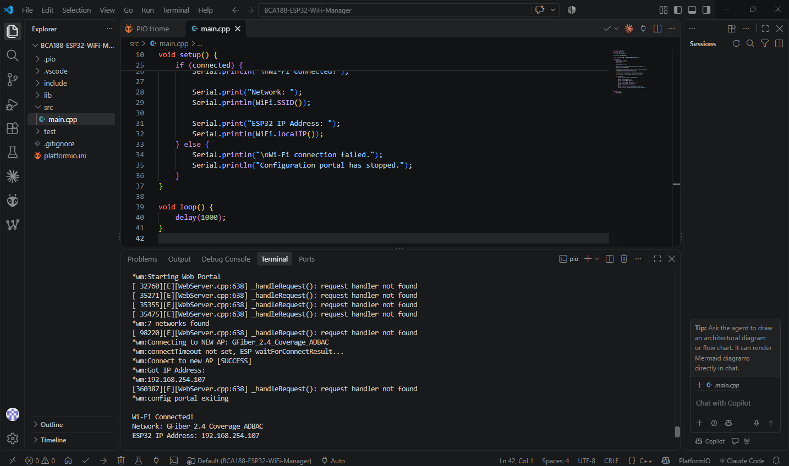
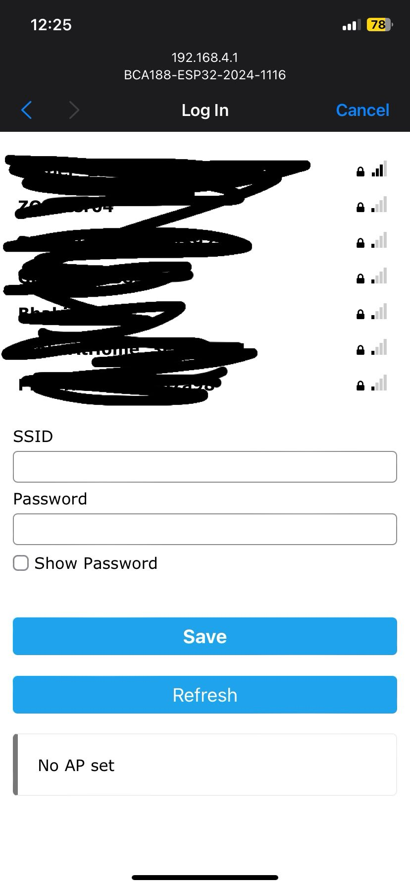
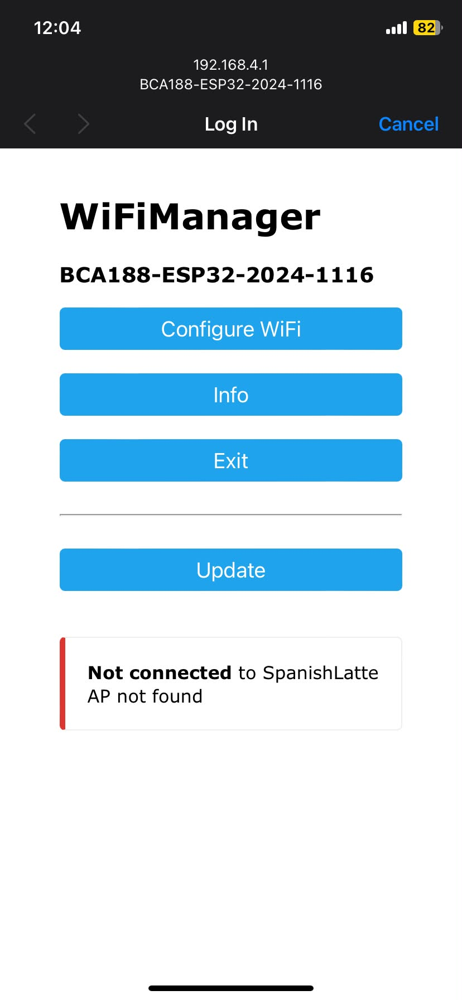

# BCA188 – ESP32 Personal Wi-Fi Manager

## Project Overview

The **ESP32 Personal Wi-Fi Manager** is an IoT project that allows users to configure the ESP32's Wi-Fi connection through a web-based configuration portal. Instead of manually changing Wi-Fi credentials in the source code, users can connect to the ESP32's access point and select their preferred Wi-Fi network using a smartphone or computer.

This project uses the **WiFiManager** library to simplify Wi-Fi configuration and connection management.

## Features

- Automatically connects to previously saved Wi-Fi credentials.
- Creates a Wi-Fi Access Point when configuration is needed.
- Provides a web-based configuration portal.
- Allows users to select and save Wi-Fi credentials without modifying the code.
- Displays connection status and the ESP32's assigned IP address through the Serial Monitor.

## Hardware Requirements

- ESP32 Development Board
- USB cable
- Computer
- Smartphone or another Wi-Fi-enabled device for configuration

## Software Requirements

- Visual Studio Code
- PlatformIO IDE extension
- Arduino Framework
- WiFiManager Library
- ESP32 Platform for PlatformIO

## Project Configuration

| Configuration | Value |
|---|---|
| Board | ESP32 Dev Module |
| Platform | Espressif32 |
| Framework | Arduino |
| Environment | `esp32dev` |
| WiFiManager Version | 2.0.17 |
| Serial Baud Rate | 115200 |
| Access Point SSID | `BCA188-ESP32-2024-1116` |
| Configuration Portal IP | `192.168.4.1` |

## Project Structure

```text
BCA188-ESP32-WiFi-Manager/
│
├── include/
├── lib/
├── src/
│   └── main.cpp
│
├── test/
├── docs/
│   └── images/
│       ├── serial-monitor.png
│       ├── wifi-network-scan.jpg
│       └── wifimanager-portal.jpg
│
├── .gitignore
├── platformio.ini
└── README.md
```

## How the Project Works

1. The ESP32 starts and initializes the Wi-Fi connection.
2. WiFiManager checks whether previously saved Wi-Fi credentials are available.
3. If valid credentials are saved, the ESP32 attempts to connect automatically.
4. If configuration is required, the ESP32 creates a Wi-Fi Access Point named `BCA188-ESP32-2024-1116`.
5. The user connects to the ESP32 Access Point using a smartphone or computer.
6. The user opens the configuration portal at `192.168.4.1`.
7. The user selects an available Wi-Fi network and enters its password.
8. WiFiManager saves the credentials and attempts to connect.
9. Once connected, the ESP32 displays the connected network and its assigned IP address in the Serial Monitor.

## Installation and Testing

1. Clone or download this repository.
2. Open the project folder in Visual Studio Code.
3. Make sure the PlatformIO extension is installed.
4. Connect the ESP32 board to the computer.
5. Open the PlatformIO terminal.
6. Build and upload the program to the ESP32.
7. Open the Serial Monitor and set the baud rate to `115200`.
8. If Wi-Fi configuration is needed, connect to the ESP32 Access Point.
9. Open `192.168.4.1` in a browser.
10. Select a Wi-Fi network and enter its password.
11. Check the Serial Monitor for the connection status and assigned IP address.

## Screenshots

### 1. ESP32 Serial Monitor

Shows the ESP32 startup process, WiFiManager messages, and Wi-Fi connection status.



### 2. Available Wi-Fi Networks

Shows the Wi-Fi configuration process and available wireless networks.



### 3. WiFiManager Configuration Portal

Shows the web-based configuration portal used to select and configure a Wi-Fi network.



## Results and Conclusion

The ESP32 Personal Wi-Fi Manager successfully demonstrates a convenient way to configure wireless connectivity using the WiFiManager library.

The project allows users to configure Wi-Fi credentials through a web portal instead of modifying the program manually. It also demonstrates how an ESP32 can operate as a Wi-Fi Access Point during configuration and connect to an existing wireless network after valid credentials are provided.

This activity provides practical experience with ESP32 programming, wireless networking, IoT device configuration, and the use of external Arduino libraries.

## Repository

GitHub Repository:  
https://github.com/Kelixtine/laboratory9-wifi-manager
